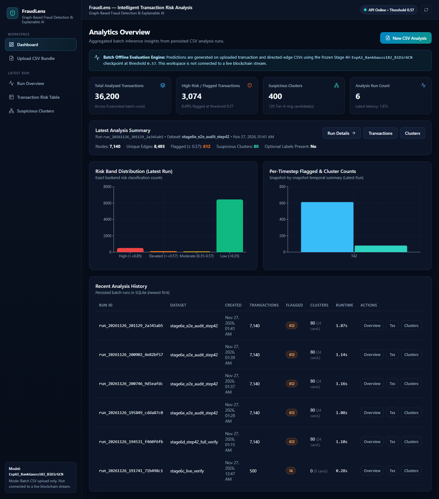
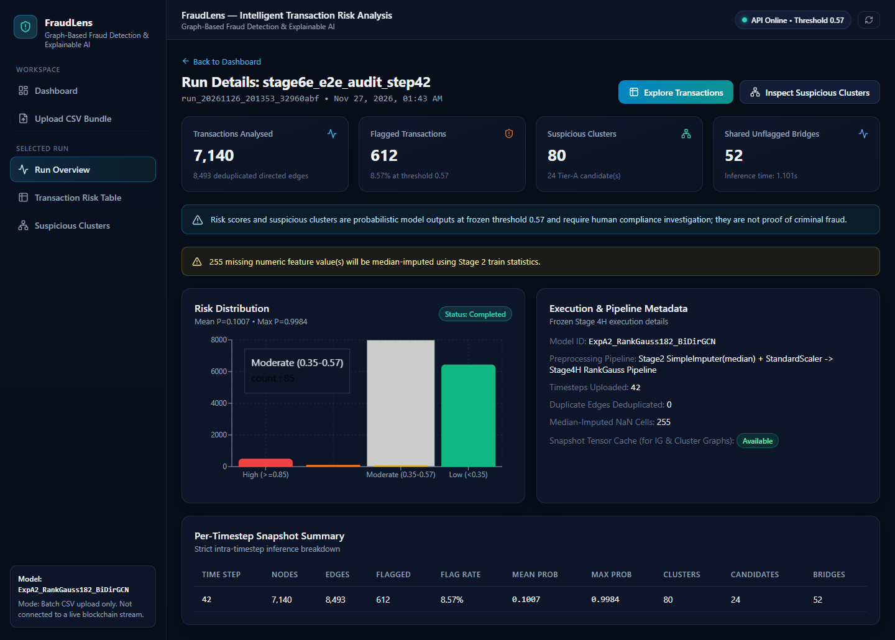
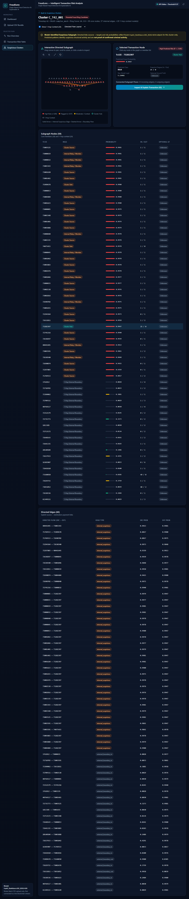
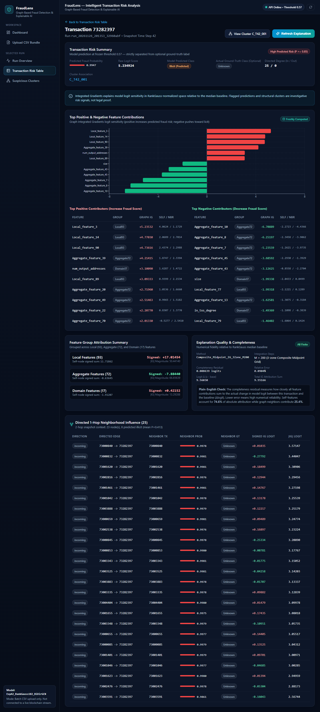
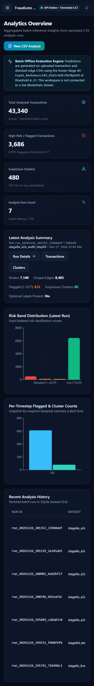

# FraudLens — Intelligent Transaction Risk Analysis

**Research Title:** *Temporal Graph Neural Networks with Real-Time Explainable AI for Online Payment Fraud Ring Detection*

An end-to-end capstone research system and full-stack interactive fraud analytics application built on the **Elliptic++ Bitcoin Transaction Graph**, combining distribution-robust **RankGauss + Bidirectional Relational GCN (`ExpA2_RankGauss182_BiDirGCN`)**, **Composite Midpoint Integrated Gradients (`M=200`)** explainability, directed **Suspicious Subgraph & Potential Fraud-Ring Detection**, a **FastAPI** inference backend, and a responsive **React + TypeScript + Cytoscape.js** dashboard.

---

## Table of Contents
1. [Project Overview & Objectives](#1-project-overview--objectives)
2. [Dataset Description (Elliptic++)](#2-dataset-description-elliptic)
3. [Research Methodology & Model Benchmark Results](#3-research-methodology--model-benchmark-results)
4. [Frozen Champion & Preprocessing Pipeline](#4-frozen-champion--preprocessing-pipeline)
5. [Application Architecture (Backend, Frontend, XAI & Persistence)](#5-application-architecture)
6. [Quick Start & Reproducible Startup Instructions](#6-quick-start--reproducible-startup-instructions)
7. [Environment Configuration](#7-environment-configuration)
8. [CSV Upload Format & User Workflow](#8-csv-upload-format--user-workflow)
9. [REST API Reference](#9-rest-api-reference)
10. [Testing & Verification Results](#10-testing--verification-results)
11. [Application Screenshots](#11-application-screenshots)
12. [Known Limitations & Honest Boundaries](#12-known-limitations--honest-boundaries)

---

## 1. Project Overview & Objectives

Online cryptocurrency and payment graphs pose major challenges for static tabular fraud models:
- **Graph Relational Structure:** Suspicious flows propagate across directed transaction chains (`peeling chains`, `fan-in`, `fan-out`, and cyclic meshes).
- **Extreme Label Sparsity & Imbalance:** Only `22.85%` of Elliptic++ transactions carry published labels (`9.76%` of labeled nodes are illicit), while `77.15%` are unlabeled (`Unknown = -1`).
- **Severe Post-Step-42 Temporal Drift:** Market/darknet shutdown events after Step `42` induce extreme feature distribution tails and structural regime shifts.

**FraudLens** unifies the validated research pipeline (`Stages 1–5E`) into an interactive web platform (`Stages 6A–6F`) enabling fraud analysts to:
1. Upload raw `transactions.csv` and directed `edges.csv` snapshots with strict zero-silent-drop validation.
2. Execute frozen BiDirGCN inference (`τ* = 0.57`) cleanly without training leakage.
3. Prioritize flagged transactions and inspect directed model-identified suspicious clusters in **Cytoscape.js**.
4. Request on-demand `M=200` Integrated Gradients feature attributions, feature-group breakdowns (`Local93`, `Aggregate72`, `Domain17`), completeness error checks, and 1-hop/2-hop neighborhood context.

---

## 2. Dataset Description (Elliptic++)

Evaluated in [dataset_inspection_report.md](reports/dataset_inspection_report.md):
- **Total Nodes (Transactions):** `203,769` across `49` discrete bi-weekly time steps (`1–49`)
- **Directed Edges:** `234,355` (`100%` intra-timestep; `0` cross-timestep edges, `0` dangling edges)
- **Feature Dimensionality:** `182` numerical features (`93` Local + `72` Aggregate + `17` Bitcoin domain metrics)
- **Ground-Truth Class Distribution:**
  - `Illicit (Class 1)`: `4,545` transactions
  - `Licit (Class 2)`: `42,019` transactions
  - `Unknown (Class 3 / y = -1)`: `157,205` transactions (preserved strictly separate from `Licit` and never used in evaluation metrics)
- **Strict Zero-Leakage Chronological Splits:**
  - **Train (`Steps 1–34`):** `29,894` labeled (`3,462` Illicit / `26,432` Licit) — *All scalers, RankGauss quantiles, and model weights fitted strictly here.*
  - **Validation (`Steps 35–41`):** `7,829` labeled (`675` Illicit / `7,154` Licit) — *Used solely for model selection and threshold calibration ($\tau^* = 0.57$).*
  - **Test (`Steps 42–49`):** `8,841` labeled (`408` Illicit / `8,433` Licit) — *Held-out post-selection evaluation (`Step 42` pre-shutdown vs `Steps 43–49` post-shutdown regime).*

---

## 3. Research Methodology & Model Benchmark Results

### Research Evolution Across Stages 1–5E
- **Stages 1–4G:** Audited temporal splits, tabular baselines (`Logistic Regression`, `MLP`, `Random Forest`, `HistGradientBoosting`), static/temporal GNNs (`GCN`, `GAT`, `GCN-LSTM`, `EvolveGCN`), feature group ablations (`Local93` vs `182`), bidirectional relational convolutions (`BiDirRelationalGCN`), and diagnosed Step 42–43 tail drift (`steps 43–49` raw `abs_max = 38.2647` post-RankGauss compression note in Stage 4H).
- **Stage 4H (Distribution-Robust Feature Learning):** Verified ([stage4h_report.md](reports/stage4h/stage4h_report.md)) that applying `QuantileTransformer(output_distribution='normal')` + `StandardScaler()` fitted strictly on `Steps 1–34` significantly improves GNN generalization and probability calibration under distribution shift.

| Model Configuration | Val PR-AUC (`35–41`) | Test All (`42–49`) PR-AUC / ROC | Test F1 / Prec / Rec | Test Brier / ECE |
| :--- | :---: | :---: | :---: | :---: |
| *HistGradientBoosting (Tabular Baseline)* | `0.9292` | `0.5646 / 0.8848` | `0.6166 / 88.53% / 47.30%` | `0.0362 / 0.0396` |
| *GCNAvg Champion (Pre-RankGauss Base)* | `0.9051` | `0.5268 / 0.8188` | `0.5965 / 85.39% / 45.83%` | `0.0740 / 0.1145` |
| `ExpA1_RankGauss182_GCNAvg` (mean) | `0.9257` | `0.5825 / 0.8858` | `0.6064 / 83.43% / 47.63%` | `0.0322 / 0.0208` |
| **`ExpA2_RankGauss182_BiDirGCN` (Winner, mean)** | **`0.9300`** | **`0.6010 / 0.8969`** | `0.5967 / 80.13% / 47.55%` | **`0.0276 / 0.0170`** |
| `ExpB2_Hybrid_GCNAvg93Emb_RegHGB` (mean) | `0.9226` | `0.5597 / 0.8739` | `0.5889 / 81.34% / 46.16%` | `0.0475 / 0.0562` |

- **Selected Frozen Champion (`seed=42`, $\tau^* = 0.57$):** Test PR-AUC = **`0.6023`**, ROC-AUC = **`0.8956`**, F1 = **`0.5972`** (`TP=192, FP=43, TN=8,390, FN=216` across `Steps 42–49`; Validation `TP=573, FP=33, TN=7,121, FN=102`).
- **Stage 5A–5E (Explainability & Subgraph Analysis):**
  - Validated a **3-Zone Composite Midpoint Integrated Gradients (`M=200`)** grid ([stage5b_ig_final_validation.md](reports/stage5/stage5b_ig_final_validation.md)) achieving max completeness error `< 0.04` logits (`< 1.0%` relative error, `0.00e+00` bitwise reproducibility).
  - Stage 5C identified `254` direct suspicious clusters (`85` Tier-A candidates) in Validation (`35–41`), `80` clusters (`24` candidates) in Test `Step 42`, and `136` clusters (`55` candidates) in `Steps 43–49`, audited independently in [stage5e_independent_audit_report.md](reports/stage5/stage5e_independent_audit_report.md) (`11 PASS`, `3 WARNING`, `0 FAIL`).

---

## 4. Frozen Champion & Preprocessing Pipeline

Every uploaded CSV batch executes the exact frozen inference chain with **zero retraining or threshold changes**:

```text
Raw CSV [txId, Time step, 182 features]  (+ directed intra-timestep edges txId1 -> txId2)
   │
   ▼ 1. Stage-2 Imputer & StandardScaler (fitted Train Steps 1–34)
      app/backend/artifacts/stage2_imputer_scaler_train_1_34.joblib
   │
   ▼ 2. Stage-4H RankGauss Pipeline (QuantileTransformer(normal) + StandardScaler, Train 1–34)
      models/stage4h/rankgauss_transformer_train_1_34.joblib
   │
   ▼ 3. Frozen Stage-4H BiDirRelationalGCN (159,937 params, .eval(), no_grad(), τ* = 0.57)
      models/stage4h/ExpA2_RankGauss182_BiDirGCN_seed42.pt
```

Numerical parity against research tensors (`processed/temporal_snapshots.pt`) on full `Step 35` (`5,507` nodes) and `Step 42` (`7,140` nodes) was verified at **`max_abs_diff = 0.00e+00`** across Stage-2 features, RankGauss features, logits, and probabilities (`100%` binary prediction match `@ 0.57`).

---

## 5. Application Architecture

### Backend (`app/backend/`)
- **FastAPI + Uvicorn** (`app/backend/main.py`, `app/backend/api/routes.py`) exposing 9 REST endpoints with CORS enabled for Vite dev (`5173`) and preview (`4173`).
- **CSV Validator** (`services/csv_validator.py`): Enforces `182` named features, unique `int64` `txId`, `Time step >= 1`, `NaN` imputation counting, non-numeric/`Inf` `HTTP 422` rejection, optional `class` isolation, and **no-silent-drop** edge checks.
- **Subgraph & XAI Services** (`services/subgraph_service.py`, `services/explainability_service.py`): Reuses Stage 5C directed clustering/motifs/ring candidacy rules and on-demand `M=200` Composite Midpoint IG (`Local93` / `Aggregate72` / `Domain17`, 1-hop/2-hop neighbors).
- **SQLite Persistence & Retention Cache** (`database/db.py`, `app/data/fraud_app.db`): Stores run summaries, transaction scores, clusters, cluster edges, and cached IG JSON payloads; ephemeral snapshot `.pt` tensors auto-prune at `50` runs / `30` days. Raw CSV bytes are never persisted.

### Frontend (`app/frontend/`)
- **React 18 + TypeScript + Vite** (`src/App.tsx`), code-split via `React.lazy()` and Rollup `manualChunks` (`13.05 kB` initial JS entry chunk).
- **Graph Visualization (`ClusterDetailPage.tsx`):** Interactive **Cytoscape.js** directed subgraph (`breadthfirst`, `cose`, `circle` layouts), zoom/pan/fit/reset toolbar, visual legend, 1-hop external context toggle, node role derivation, and synced node/edge inspector.
- **Charts & XAI (`DashboardPage.tsx`, `RunDetailsPage.tsx`, `TransactionDetailPage.tsx`):** Recharts risk distributions, per-timestep trend charts, and on-demand positive/negative IG contribution bar chart + feature-group & completeness panels.

---

## 6. Quick Start & Reproducible Startup Instructions

### Prerequisites
- **Python 3.10+** (verified on `Python 3.12.0`)
- **Node.js 18+** & **npm** (verified on `Node v24.15.0`, `npm 11.12.1`)

### Fresh Setup Installation
See the full step-by-step beginner guide: [docs/INSTALLATION_GUIDE_FRESH_WINDOWS.md](docs/INSTALLATION_GUIDE_FRESH_WINDOWS.md).

```powershell
# 1. Create and activate Python virtual environment
python -m venv venv
.\venv\Scripts\activate

# 2. Install backend & ML dependencies
.\venv\Scripts\python.exe -m pip install -r app\backend\requirements.txt

# 3. Install frontend Node dependencies
npm --prefix app/frontend install
```

On first backend launch (`.\start_backend.bat` or `.\start_fraudlens.bat`), FraudLens automatically creates `app/data/fraud_app.db` (SQLite) and `app/data/runs_cache/` locally using only frozen models and preprocessing artifacts already included in the repository.

### One-Click Windows Launchers (Recommended)
Double-click or run from the project root using relative paths:
```powershell
.\start_fraudlens.bat
```
Or launch individually in two terminals:
- **Backend (`http://127.0.0.1:8010`):** `.\start_backend.bat` (or `.\venv\Scripts\python.exe -m uvicorn app.backend.main:app --host 127.0.0.1 --port 8010`)
- **Frontend (`http://127.0.0.1:5173`):** `.\start_frontend.bat` (or `npm --prefix app/frontend run dev`)

---

## 7. Environment Configuration

- Frontend API URL defaults to `http://127.0.0.1:8010` cleanly without configuration.
- To point the frontend at a custom backend URL, copy [`app/frontend/.env.example`](app/frontend/.env.example) to `app/frontend/.env.local` and set `VITE_API_BASE_URL`.
- No secrets, API keys, or external credentials are required or stored in the repository.

---

## 8. CSV Upload Format & User Workflow

Full column specification, error codes, and try-it-now templates are documented in [docs/CSV_FORMAT_AND_USER_GUIDE.md](docs/CSV_FORMAT_AND_USER_GUIDE.md).
1. Check **API Online • Threshold 0.57** in the top navigation bar.
2. Open **Upload CSV Bundle** (`/upload`), drag-and-drop or browse `app/sample_data/transactions_sample.csv` and `app/sample_data/edges_sample.csv` (optionally `classes_optional_sample.csv`).
3. Click **1. Validate CSV Bundle** to verify exact `182` features and intra-timestep edge integrity.
4. Click **2. Run Fraud Analysis** to generate predictions and inspect KPIs on `/runs/:runId`.
5. Filter & search **Transaction Risk Table**, inspect suspicious groups in **Suspicious Clusters**, explore directed topologies in **Cluster Detail**, and click **Explain Prediction (IG)** on any transaction to inspect `M=200` feature & neighbor attributions.

---

## 9. REST API Reference

See full endpoint parameters and caching rules in [docs/API_REFERENCE.md](docs/API_REFERENCE.md):
- `GET /api/health`
- `POST /api/validate-csv`
- `POST /api/analyze`
- `GET /api/runs` & `GET /api/runs/{run_id}`
- `GET /api/runs/{run_id}/transactions`
- `GET /api/runs/{run_id}/clusters` & `GET /api/runs/{run_id}/clusters/{cluster_id}/graph`
- `POST /api/runs/{run_id}/transactions/{tx_id}/explain`

---

## 10. Testing & Verification Results

```powershell
# Standalone backend API, validation, leakage & SQLite tests (7/7 PASS without raw dataset/)
.\venv\Scripts\python.exe -m pytest -v app/backend/tests/test_stage6b_backend.py -k "not (end_to_end_run_queries or numerical_parity)"

# Full backend suite incl. Step 35 & Step 42 parity (10/10 PASS when raw dataset/ + processed/temporal_snapshots.pt exist locally)
.\venv\Scripts\python.exe -m pytest -v app/backend/tests/test_stage6b_backend.py

# Frontend React component & XAI/Cytoscape Vitest suite (8/8 PASS)
npm --prefix app/frontend test

# TypeScript check & production Vite build (0 errors, 0 chunk warnings)
npm --prefix app/frontend run build
```

Real headless Google Chrome Playwright end-to-end tests (`Stage 6E`) also verified all `12` user journey steps (`0` console errors, `0` page errors, `0 px` horizontal overflow across `1440x900`, `1366x768`, `768x1024`, and `390x844` viewports).

---

## 11. Application Screenshots

Captured during live end-to-end Chrome validation under [`reports/stage6/evidence/stage6e/`](reports/stage6/evidence/stage6e):

| View | Preview / Link |
| :--- | :--- |
| **Dashboard (`1440x900`)** |  |
| **Run Details & Charts** |  |
| **Cluster Directed Graph (`Cytoscape`)** |  |
| **On-Demand `M=200` Transaction XAI** |  |
| **Mobile Responsive (`390x844`)** |  |

---

## 12. Known Limitations & Honest Boundaries

- **Batch CSV Mode Only:** Operates offline on uploaded transaction/edge CSV snapshots (`streaming_supported: false`); **not** connected to a live blockchain node or streaming pipeline.
- **Single-Analyst Local Architecture:** No authentication/multi-tenant RBAC; intended for local workstation or research review.
- **Investigative Signal, Not Legal Proof:** Predicted probabilities (`>= 0.57`) and Tier-A clusters prioritize human compliance triage and do not represent confirmed criminal proof.
- **Post-Shutdown Drift (`Steps 43–49`):** Frozen Stage 4H weights experience structural/feature shift after darknet market closure (`Steps 43–49`), as diagnosed in Stage 4G and Stage 5C.
- **CPU IG Latency & Cache Retention:** First-time `M=200` Integrated Gradients computation takes `~28s` on a `7,140`-node snapshot on CPU (`~23ms` when cached); uncached tensor snapshots prune after `50` runs / `30` days.

---

## Author & Acknowledgements
- **Author:** Mansi Upadhyay
- **Capstone Project:** Final Year B.Tech Computer Science & Engineering Capstone Project
- **Dataset Reference:** *Elliptic++: An Enriched Bitcoin Transaction Dataset for Fraud Detection* (Youssef et al., 2023).
