# Stage 2: Data Preprocessing & Temporal Graph Construction Report

**Project Title:** Temporal Graph Neural Networks with Real-Time Explainable AI for Online Payment Fraud Ring Detection  
**Generated On:** 2026-10-13 11:49:50  
**Dataset:** Elliptic++ Bitcoin Transaction Graph  

---

## 1. Executive Summary & Graph Specifications

| Specification | Value | Technical Details |
| :--- | :--- | :--- |
| **Total Graph Nodes ($N$)** | **203,769** | Bitcoin transactions sorted deterministically by `(Time step, txId)` |
| **Total Directed Edges ($E$)** | **234,355** | Directed fund transfer flows between transactions |
| **Input Feature Dimension ($D$)** | **182** | 93 Local + 72 Aggregate + 17 Domain Features |
| **Discrete Temporal Snapshots** | **49** | Distinct 2-week subgraphs (Steps 1 to 49) |
| **Total Supervised (Labeled) Nodes** | **46,564** | Ground-truth Illicit (`1`) and Licit (`0`) nodes |
| **Background / Unlabeled Nodes** | **157,205 (77.15%)** | Retained in graph topology for message passing (`y = -1`) |
| **Imputation & Scaling Strategy** | **Train-Only Fitted (Zero Leakage)** | Imputer & Scaler fitted strictly on steps 1–34 |
| **PyG Artifacts Created** | **`elliptic_pyg_data.pt`, `temporal_snapshots.pt`** | Ready for baseline and Temporal GNN architectures |

---

## 2. Chronological Temporal Data Splits

To evaluate realistic fraud detection capability without future-information leakage, the 49 time steps are partitioned chronologically:

```mermaid
gantt
    title Temporal Train / Validation / Test Split (49 Time Steps)
    dateFormat X
    axisFormat Step %s
    section Training Period
    Train Snapshots (Steps 1-34) :active, 1, 34
    section Validation Period
    Validation Snapshots (Steps 35-41) :crit, 35, 41
    section Testing Period
    Test Snapshots (Steps 42-49) :done, 42, 49
```

### Detailed Split Breakdown:

| Split | Timesteps | Total Nodes | Total Edges | Labeled Nodes | Illicit (Fraud, `y=1`) | Licit (Legitimate, `y=0`) | Illicit Ratio |
| :--- | :--- | :--- | :--- | :--- | :--- | :--- | :--- |
| **Train** | Steps 1 – 34 | 136,265 | 156,843 | **29,894** | 3,462 | 26,432 | **11.58%** |
| **Validation** | Steps 35 – 41 | 30,680 | 35,360 | **7,829** | 675 | 7,154 | **8.62%** |
| **Test** | Steps 42 – 49 | 36,824 | 42,152 | **8,841** | 408 | 8,433 | **4.61%** |
| **Total** | Steps 1 – 49 | **203,769** | **234,355** | **46,564** | **4,545** | **42,019** | **9.76%** |

---

## 3. Data Preprocessing & Leakage Prevention Strategy

1. **Missing Value Imputation:**
   - As identified in Stage 1, 965 transactions had missing values in the 17 domain features.
   - `SimpleImputer(strategy='median')` was fitted **exclusively on the training period (steps 1–34)**.
   - The fitted median statistics were then applied to transform the validation (steps 35–41) and test (steps 42–49) features.
2. **Feature Standardization:**
   - `StandardScaler()` was fitted **exclusively on the training period (steps 1–34)** and applied to validation and test periods.
   - This ensures that mean and variance statistics from future time steps do not leak into model training.
3. **Graph Topology Leakage Check:**
   - 100% of edges in `txs_edgelist.txt` connect transactions within the exact same time step.
   - There are **0 cross-timestep edges**, confirming that message passing within any time step snapshot cannot leak future graph connections.

---

## 4. Verification & Integrity Checklist

All automated validation checks passed successfully:

- [x] **Total Node Count:** 203,769 / 203,769 matching
- [x] **Total Edge Count:** 234,355 / 234,355 matching
- [x] **Edge Index Range:** Minimum index = 0, Maximum index = 203,768 (all within valid bounds)
- [x] **Missing / Infinite Values:** 0 NaNs and 0 Infs in feature tensor $X$
- [x] **Mask Disjointness:** Train, Val, and Test masks are strictly mutually exclusive
- [x] **Supervision Mask Purity:** Unlabeled nodes (`class = 3`, `y = -1`) are strictly excluded from `train_mask`, `val_mask`, and `test_mask`
- [x] **Snapshot Validity:** All 49 temporal subgraphs re-indexed and verified with zero out-of-bounds edge references

---

## 5. Generated Artifacts

The following files have been saved to `processed/`:
1. `processed/elliptic_pyg_data.pt`: Full consolidated PyTorch Geometric `Data` object containing `x`, `edge_index`, `y`, `timestep`, `txId`, and boolean masks (`train_mask`, `val_mask`, `test_mask`, `labeled_mask`).
2. `processed/temporal_snapshots.pt`: Sequence of 49 distinct PyG `Data` subgraphs for sequential/rolling-window Temporal GNN training.
3. `processed/tabular_data.npz`: Compressed NumPy format for standard baseline models (Random Forest, XGBoost, MLP, Logistic Regression).
4. `processed/metadata.json`: Complete configuration and schema mappings.

---

## 6. Next Step
Proceed to **Stage 3: Baseline Fraud Classifier Implementation** (evaluating non-graph and static tabular baselines such as Logistic Regression, Random Forest, and MLP to establish a rigorous performance benchmark before Temporal GNN modeling).
