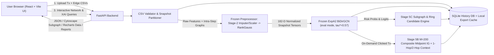

# Stage 6A: Application Architecture & Existing Project Inspection Report

**Generated On:** 2026-11-26  
**Phase Scope:** Inspection and Architecture Planning ONLY (Zero frontend/backend code written, zero package installations, zero modifications to Stage 1–5 artifacts).  
**Frozen Model Target:** `ExpA2_RankGauss182_BiDirGCN` (`seed=42`, $\tau^* = 0.57$)

---

## 1. Existing Repository Assessment & Reusable Assets

### 1.1 Exact Core Artifacts for Model Inference
Inspection of Stages 1–5E confirmed the complete set of frozen files required for deterministic, label-free inference:
- **Champion Weights & Threshold:** [`models/stage4h/ExpA2_RankGauss182_BiDirGCN_seed42.pt`](file:///c:/Users/mansi/Downloads/Capstone_Fraud_Detection/models/stage4h/ExpA2_RankGauss182_BiDirGCN_seed42.pt)
  - Contains keys `exp_id`, `arch_name='BiDirGCN_182'`, `seed=42`, `total_parameters=159,937`, `model_state_dict`, and `threshold_recal_01_99=0.57`.
- **RankGauss Feature Pipeline:** [`models/stage4h/rankgauss_transformer_train_1_34.joblib`](file:///c:/Users/mansi/Downloads/Capstone_Fraud_Detection/models/stage4h/rankgauss_transformer_train_1_34.joblib)
  - `sklearn.pipeline.Pipeline` with `qt` (`QuantileTransformer(n_quantiles=1000, output_distribution='normal')`) + `post_scaler` (`StandardScaler()`), fitted on Train Steps `1–34`.
- **Feature Ordering & Metadata:** [`processed/metadata.json`](file:///c:/Users/mansi/Downloads/Capstone_Fraud_Detection/processed/metadata.json)
  - Exact ordered list `feature_columns` (`182` columns = `Local_feature_1..93` [`0..92`], `Aggregate_feature_1..72` [`93..164`], and `17` Domain features `in_txs_degree..out_BTC_total` [`165..181`]).
- **Critical Stage-2 Raw-to-Scaled Preprocessing Gap Discovered:**  
  Inspection of [`preprocess_graph.py`](file:///c:/Users/mansi/Downloads/Capstone_Fraud_Detection/preprocess_graph.py#L146-L162) and [`src/train_stage4h.py`](file:///c:/Users/mansi/Downloads/Capstone_Fraud_Detection/src/train_stage4h.py#L50-L75) revealed that Stage 2 fitted `SimpleImputer(strategy='median')` and `StandardScaler()` on raw [`dataset/txs_features.txt`](file:///c:/Users/mansi/Downloads/Capstone_Fraud_Detection/dataset/txs_features.txt) (`Steps 1–34`), saved only the scaled tensors (`temporal_snapshots.pt`), and did **not** export the Stage-2 imputer/scaler `.joblib` object. Stage 4H then fitted `rankgauss_transformer_train_1_34.joblib` on top of those Stage-2-scaled tensors.  
  - **Empirical Verification (`Step 35` read-only check):** Reconstructing Stage 2's `SimpleImputer(median) + StandardScaler` from raw `dataset/txs_features.txt` (`Steps 1–34`) matched `processed/temporal_snapshots.pt[34].x` to **`max_x_diff = 0.00e+00`** and produced **`max_prob_diff = 0.00e+00`** (`515` flagged nodes at $\tau^*=0.57$).  
  - **Action Required in Stage 6B:** Materialize a read-only exported Stage-2 preprocessor (`app/backend/artifacts/stage2_imputer_scaler_train_1_34.joblib`) once from `dataset/txs_features.txt` (`Steps 1–34`) so raw user CSV uploads run `Stage2(Imputer+StandardScaler) -> RankGauss(qt+post_scaler) -> BiDirGCN` identically.

### 1.2 Reusable Code Modules (To Refactor Cleanly into Application Services)
Rather than importing research runner scripts that assume `processed/` files or print training banners, Stage 6B will build clean inference wrappers around these verified functions/classes:
- **Neural Architecture & Adjacency Builder:** `BiDirRelationalGCN`, `BiDirGCNLayer`, `build_true_directed_gcn_adj` from [`src/models_stage4f.py`](file:///c:/Users/mansi/Downloads/Capstone_Fraud_Detection/src/models_stage4f.py#L28-L210).
- **Feature Group Mapping:** `assign_feature_group` (`Local93` / `Aggregate72` / `Domain17`) from [`src/stage5/stage5a_feature_importance.py`](file:///c:/Users/mansi/Downloads/Capstone_Fraud_Detection/src/stage5/stage5a_feature_importance.py#L44-L51).
- **Validated $M=200$ Attribution Engine:** 3-zone Composite Midpoint Integrated Gradients (`60@[0, 0.005] + 60@[0.005, 0.05] + 80@[0.05, 1.0]`, baseline $X=0$, `< 0.04` logits / `< 1.0%` completeness error verified in [`stage5b_ig_final_validation.md`](file:///c:/Users/mansi/Downloads/Capstone_Fraud_Detection/reports/stage5/stage5b_ig_final_validation.md)) + 1-hop/2-hop topological attribution partitioning from [`src/stage5/stage5b_individual_explanations.py`](file:///c:/Users/mansi/Downloads/Capstone_Fraud_Detection/src/stage5/stage5b_individual_explanations.py#L290-L430).
- **Suspicious Subgraph & Candidate Detection:** Direct WCC extraction ($P \ge 0.57$, $|C| \ge 2$), label-free candidacy criteria ($|C| \ge 3$, $\bar{P} \ge 0.75$, $\ge 2$ core nodes $P \ge 0.85$, $\ge 2$ edges), `RingScore`, `classify_directed_motif`, and shared unflagged bridge analysis from [`src/stage5/stage5c_fraud_ring_analysis.py`](file:///c:/Users/mansi/Downloads/Capstone_Fraud_Detection/src/stage5/stage5c_fraud_ring_analysis.py#L75-L340).

### 1.3 Environment Inspection
- **Python `venv` (`3.x`) Installed:** `torch==2.14.1`, `torch-geometric==2.8.0.post1`, `scikit-learn==1.9.1`, `scipy==1.18.1`, `pandas==3.0.6`, `numpy==2.5.3`, `joblib==1.6.0`, `networkx==3.7`, `pillow==12.3.0`.
- **Node.js Runtime Installed:** `Node v24.15.0`, `npm 11.12.1`.
- **Missing Backend Packages (install in Stage 6B):** `fastapi`, `uvicorn[standard]`, `python-multipart`, `pydantic` (and `httpx`, `pytest` for API verification).
- **Missing Frontend Packages (install in Stage 6C):** `react`, `react-dom`, `vite`, `@vitejs/plugin-react`, `typescript` (or clean JS), `recharts`, `cytoscape`, `lucide-react`.

---

## 2. Proposed Folder Structure (Strict Isolation From Stages 1–5)

```text
Capstone_Fraud_Detection/
├── dataset/, processed/, models/, results/, reports/, figures/, src/   # UNTOUCHED (Stages 1-5)
├── reports/stage6/                                                    # Stage 6 planning & audit docs
└── app/                                                               # Isolated Web Application
    ├── data/                                                          # Runtime SQLite DB & UUID upload/export cache
    ├── sample_data/                                                   # Curated demo CSV bundles (e.g., Step 35, Step 42)
    ├── backend/
    │   ├── artifacts/                                                 # Read-only copy/cache of Stage-2 imputer+scaler
    │   ├── app_config.py                                              # Frozen model/threshold/schema constants
    │   ├── main.py                                                    # FastAPI app, CORS, router registration
    │   ├── db.py                                                      # SQLite persistence layer
    │   ├── schemas.py                                                 # Pydantic request/response contracts
    │   └── services/
    │       ├── csv_validator.py                                       # Two-CSV validation & snapshot partitioning
    │       ├── inference_service.py                                   # Stage2 -> RankGauss -> BiDirGCN inference
    │       ├── subgraph_service.py                                    # Stage 5C clusters, motifs & shared bridges
    │       ├── explainability_service.py                              # On-demand M=200 IG + neighborhood breakdown
    │       └── export_service.py                                      # Investigation CSV/JSON/Markdown reports
    └── frontend/
        ├── package.json
        ├── vite.config.ts
        └── src/
            ├── api/client.ts                                          # Typed FastAPI HTTP client
            ├── components/
            │   ├── UploadPanel.tsx                                    # Dual-CSV drag-drop + sample selector
            │   ├── SummaryKPIs.tsx                                    # Run totals, regime warnings, score distributions
            │   ├── TransactionTable.tsx                               # Searchable/filterable risk table + selection
            │   ├── NetworkGraphModal.tsx                              # Interactive Cytoscape.js directed graph viewer
            │   ├── ExplanationDrawer.tsx                              # M=200 signed IG waterfall + neighbor breakdown
            │   └── ClustersPanel.tsx                                  # Fraud-ring candidates, motifs & bridges
            └── App.tsx
```

---

## 3. Exact CSV Input Specification

Because the trained model requires both per-transaction attributes and directed payment links (`txId1 -> txId2`), the application uses a **Two-CSV Upload Workflow** matching [`preprocess_graph.py`](file:///c:/Users/mansi/Downloads/Capstone_Fraud_Detection/preprocess_graph.py#L61-L176):

1. **File 1 — Transactions CSV (Required):** e.g., `transactions.csv` (Elliptic++ `txs_features.txt` schema).
   - **Required Columns (`184` total):**
     - `txId`: unique integer (`int64`, non-null, `> 0`) — primary transaction identifier.
     - `Time step`: integer snapshot index (`int64`, non-null, `>= 1`).
     - Exact `182` float feature columns in order matching `metadata.json["feature_columns"]`: `Local_feature_1`..`Local_feature_93`, `Aggregate_feature_1`..`Aggregate_feature_72`, `in_txs_degree`, `out_txs_degree`, `total_BTC`, `fees`, `size`, `num_input_addresses`, `num_output_addresses`, `in_BTC_min`, `in_BTC_max`, `in_BTC_mean`, `in_BTC_median`, `in_BTC_total`, `out_BTC_min`, `out_BTC_max`, `out_BTC_mean`, `out_BTC_median`, `out_BTC_total`.
   - **Optional Column (Strictly Ignored During Inference):**
     - `class`: optional ground-truth column (`1` = Illicit, `2` or `0` = Licit, `3` or `-1` or empty = Unknown). Never fed into preprocessing or `BiDirGCN`; used solely for optional post-hoc benchmark statistics if provided. Missing `class` defaults every node to `Unknown (-1)`.
   - **Feature Scale Assumption:** Accepts **raw unscaled Elliptic++ transaction features** and applies the frozen `Stage-2 (Median Imputer + StandardScaler) -> RankGauss -> StandardScaler` pipeline deterministically.

2. **File 2 — Directed Edges CSV (Required):** e.g., `edges.csv` (Elliptic++ `txs_edgelist.txt` schema).
   - **Required Columns:**
     - `txId1`: integer (`int64`, non-null) — directed source (sending transaction).
     - `txId2`: integer (`int64`, non-null) — directed destination (receiving transaction).
   - **Graph Integrity Rules:**
     - Preserves original direction `txId1 -> txId2` for `build_true_directed_gcn_adj(direction='in'/'out')`.
     - **Missing / Dangling Edges:** Edges referencing a `txId` absent from File 1 are rejected cleanly (or optionally quarantined with exact dropped-edge warning report; strict validation default: reject with clear count of offending IDs, plus an optional toggle or clear pre-validation breakdown).
     - **Cross-Timestep Edges:** Elliptic++ snapshots are strictly intra-timestep (`0` cross-timestep edges across all `234,355` raw edges). Validation blocks or isolates cross-timestep edges cleanly and reports exact violations.
     - **Duplicate Edges / Self-Loops:** Exact duplicate `(txId1, txId2)` rows are deduplicated cleanly; isolated nodes (degree `0`) are valid and supported via self-loops (`adj` weight `1.0`).

3. **Data Types, Missing Values & Duplicates Policy:**
   - Numeric parsing enforces finite `float32`/`float64` (rejecting strings/`Inf`).
   - `NaN` values in `182` feature columns are allowed and imputed identically to Stage 2 via Train `1–34` medians (`SimpleImputer`). `NaN` in `txId`, `Time step`, `txId1`, or `txId2` triggers a structured `422 Unprocessable Entity` validation payload detailing offending rows/columns.
   - Duplicate `txId` rows in File 1 are rejected with `422` listing sample duplicate IDs.

**Recommended UX for Two-CSV Upload:** Provide paired dropzones (**1. Transactions CSV**, **2. Directed Edges CSV**) + **"Load Built-In Elliptic++ Validation Sample (e.g., Step 35 / Step 42)"** demo buttons so reviewers can test the full workflow in one click without crafting a 184-column CSV manually, plus pre-flight validation feedback before launching analysis.

---

## 4. Application Architecture & Feasibility



### 4.1 Model Integration Feasibility Assessment
Every critical inference prerequisite is verified feasible with zero changes to Stage 4H weights:
- **Checkpoint & RankGauss Loading:** `BiDirRelationalGCN(182, 128, 64, 0.3)` + `rankgauss_transformer_train_1_34.joblib` load cleanly on CPU (`~50ms`) with `model.eval()`.
- **Adjacency & Directed Message Passing:** Snapshot-by-snapshot `build_true_directed_gcn_adj(edge_index, num_nodes, 'in'/'out')` reproduces exact directional message passing and isolates snapshots cleanly (`no_grad`).
- **Probability & Frozen Threshold:** `torch.sigmoid(logits)` compared strictly against loaded `ckpt['threshold_recal_01_99'] = 0.57`.
- **Latency & Asynchronous Explainability Design:**
  - **Batch Snapshot Inference (`POST /api/analyze`):** Forward inference + Stage 5C clustering on a typical `2,500–7,500`-node snapshot takes **`~0.2–1.5 seconds`** on CPU!
  - **On-Demand $M=200$ IG Attribution (`POST /api/runs/{id}/transactions/{tx_id}/explain`):** Because a full `200`-step backward pass on CPU takes **`~15–35 seconds`** per transaction, running IG on thousands of transactions during upload would time out! Therefore, inference + ring detection run immediately upon submission, while exact $M=200$ Composite Midpoint IG computes **on-demand when a user clicks a node/hub**, and the result is **cached in SQLite** so repeat inspections are instant!

### 4.2 Database Evaluation (MySQL vs. SQLite for v1)
- **Recommendation: Use SQLite (`app/data/fraud_app.db`) for v1, NOT MySQL.**
  - *Why:* MySQL requires external daemon installation/configuration, credentials management, and schema migrations without adding analytical value for a single-node capstone web app. Python's built-in `sqlite3` requires **zero extra dependencies**, stores analysis runs, snapshot summaries, transaction risk rows, candidate clusters, and cached `M=200` IG JSON explanations transactionally, and can be swapped to PostgreSQL/MySQL later via a thin repository interface if multi-tenant deployment is needed.

---

## 5. API Endpoint Design

| Method & Path | Purpose | Key Payload / Response |
| :--- | :--- | :--- |
| `GET /api/health` | Service readiness & model metadata | Confirms frozen `ExpA2` ckpt hash, $\tau^*=0.57$, preprocessing loaded |
| `GET /api/samples` | List built-in read-only demo CSV snapshots | Step 35 (`Val`), Step 42 (`Test Pre-Shutdown`) sample descriptors |
| `POST /api/validate-csv` | Validate dual CSVs before scoring | Multipart CSVs (or sample ID) $\to$ schema check, node/edge/step counts, warnings |
| `POST /api/analyze` | Run frozen Stage 2 $\to$ RankGauss $\to$ `BiDirGCN` + Stage 5C clusters | Creates `run_id` in SQLite; returns per-step KPIs, risk histogram, top candidates |
| `GET /api/runs` | List past investigation runs from SQLite | History table (`run_id`, timestamp, dataset name, flagged count, status) |
| `GET /api/runs/{run_id}` | Full summary of one stored run | Timestep stats, class breakdown (Unknown distinct), regime/caveat notices |
| `GET /api/runs/{run_id}/transactions` | Paginated/filtered transaction table | Filter by `timestep`, `min_prob`, `flagged_only`, `search_tx_id`, sort order |
| `GET /api/runs/{run_id}/clusters` | Stage 5C suspicious clusters & candidates | Tier (`Candidate`/`Pair`/`Multi-Node`), `motif_type`, `RingScore`, `hub_tx_id` |
| `GET /api/runs/{run_id}/clusters/{cid}/graph` | Cytoscape-ready directed network + 1-hop bridges | Nodes (`txId`, `prob`, `gt_label`, `role`), directed edges (`source -> target`) |
| `POST /api/runs/{run_id}/transactions/{tx_id}/explain` | Compute/retrieve cached `M=200` Composite Midpoint IG | Top positive/negative features, Self vs. Neighbor IG, 1-hop directed neighbors, completeness err |
| `GET /api/runs/{run_id}/export/{fmt}` | Downloadable report (`csv`, `json`, `md`) | Sanitized CSV predictions, cluster summaries, or human-readable investigation report |

---

## 6. Defined User Workflow (Historical Snapshot Batch Analysis)

1. User opens the React dashboard and chooses **Upload Transaction + Edge CSVs** (or clicks a built-in demo snapshot bundle).
2. Backend validates columns (`txId`, `Time step`, `182` features; `txId1`, `txId2`), finite values, duplicates, intra-timestep edge alignment, and preserves optional `class` labels strictly outside inference.
3. Validation panel displays pre-flight summary (`N` transactions, `E` edges, timesteps covered, missing values imputed, warnings). User clicks **Run Fraud Analysis**.
4. Backend applies Stage-2 median imputation + StandardScaler $\to$ frozen Train `1–34` RankGauss pipeline, partitions graphs per snapshot, and runs frozen `ExpA2_RankGauss182_BiDirGCN` inference ($\tau^*=0.57$).
5. Backend runs Stage 5C directed clustering, `RingScore` ranking, motif classification, and unflagged shared-bridge detection, persisting results to SQLite.
6. Dashboard updates KPI cards, Recharts probability/temporal charts, **Transaction Risk Table**, and **Candidate Fraud-Ring Clusters** list (explicitly noting model scores vs. non-criminal-proof disclaimer and post-Step-42 shift limitations when applicable).
7. Clicking any candidate cluster opens an interactive **Cytoscape.js directed graph** showing `src -> dst` arrows, cluster hubs, flagged members, and shared bridges.
8. Clicking any transaction triggers (or fetches cached) **$M=200$ Composite Midpoint IG explanation**, rendering Recharts positive/negative drivers, Self vs. Neighbor IG balance, completeness error badge, and directed 1-hop neighbor table.
9. User exports a sanitized **Investigation Report** (Markdown / CSV / JSON).

> **Scope Clarification (No Streaming Claims):** This application performs **historical snapshot-batch CSV analysis** matching the discrete Elliptic++ snapshot architecture (`0` cross-timestep edges). It does **not** perform real-time mempool/payment stream ingestion or online weight updates.

---

## 7. Security, Validation & Edge-Case Requirements

- **Upload Limits & DoS Guard:** Enforce configurable max upload size (e.g. `100 MB`) and max node/edge counts cleanly with `413 Payload Too Large` before loading huge payloads into PyTorch sparse ops.
- **Path-Traversal Isolation:** Never use user filenames in filesystem paths; assign server-generated `UUIDv4` run IDs.
- **CSV Formula Injection Sanitization:** Prefix exported CSV string fields starting with `=`, `+`, `-`, `@` cleanly when exporting investigation tables.
- **Safe Checkpoint Handling:** Load only the hardcoded local trusted path `ExpA2_RankGauss182_BiDirGCN_seed42.pt`; never accept user-uploaded `.pt` or `.joblib` files (prevents pickle arbitrary code execution).
- **CORS & Input Parsing:** Restrict FastAPI CORS strictly to Vite dev/preview localhost origins (`http://localhost:5173`, `http://127.0.0.1:5173`).

---

## 8. Recommended Implementation Sequence (Stages 6B–6F)

1. **Stage 6B — Backend Core & Inference API (`app/backend/`):**
   - Install `fastapi`, `uvicorn[standard]`, `python-multipart`, `httpx`, `pytest`.
   - Export & verify `stage2_imputer_scaler_train_1_34.joblib` (`0.00e+00` diff vs `temporal_snapshots.pt`).
   - Implement CSV validator, frozen inference wrapper, Stage 5C clustering service, on-demand cached `M=200` IG service, SQLite DB, export generator, and export curated `app/sample_data/` CSVs (`Step 35`, `Step 42`). Verify all FastAPI endpoints via integration tests.
2. **Stage 6C — Frontend Foundation (`app/frontend/`):**
   - Scaffold Vite + React app (`recharts`, `cytoscape`, `lucide-react`), responsive layout, upload + pre-flight validation UI, API client, and SQLite run-history switcher.
3. **Stage 6D — Interactive Dashboard, Cytoscape Networks & XAI Drawer:**
   - Implement Transaction Risk Table, Recharts probability/cluster distribution charts, interactive Cytoscape.js directed cluster viewer (`src -> dst`), and on-demand `M=200` IG waterfall + 1-hop neighbor explanation panel.
4. **Stage 6E — End-to-End Integration Testing & Accuracy Verification:**
   - Test full browser + FastAPI flows on valid sample CSVs (`Step 35`, `Step 42`), verify predictions/clusters/IG match Stage 4H/5B/5C identically, and verify `422` handling on malformed/duplicate/bad-edge CSVs.
5. **Stage 6F — Final Polish, Documentation & Stage 1–5 Immutability Audit:**
   - Finalize `README`/startup instructions, verify Stage 1–5 SHA-256 integrity untouched, and produce final Stage 6 completion report.

---

## 9. Technical Risks & Unresolved Questions

1. **On-Demand IG Latency on Large Graphs:** Single-node `M=200` IG backward pass takes `~15–35s` on CPU. *Mitigation:* Execute lazily on node click, display non-blocking loading spinner, cache per `(run_id, tx_id)` in SQLite, and optionally expose step budget metadata.
2. **Raw vs. Pre-Scaled CSV Ambiguity:** External users preparing CSVs manually might accidentally export already-standardized values from `processed/` instead of raw `txs_features.txt` scale. *Question for Review:* Should v1 strictly require raw Elliptic++-scale CSVs (`txs_features.txt` schema — recommended cleanly) and display clear feature-range warnings if input medians already look `StandardScaler`-centered?
3. **Large Cytoscape Graph Readability:** If a user uploads many timesteps or a snapshot contains dense giant components, rendering all nodes in browser degrades FPS. *Mitigation:* Render only selected **clusters (`|C| >= 2`) + 1-hop bridges** or a user-selected node's **1-hop/2-hop ego subgraph**, never the entire `5,000+`-node snapshot graph at once.
4. **Regime-Shift Calibration Warning:** On post-Step-42 regime data, frozen $\tau^*=0.57$ recall drops sharply (Stage 4G/5C finding). The UI should display an explicit model scope banner explaining historical training range (`Steps 1–34`) and that outputs represent predicted risk indicators rather than confirmed fraud.
